# Speech Recognition <br> (DSAI 456)
## Lecture 4: Alignment and Hidden Markov Models

**Prof. Mohamed Ghalwash**
<Email v="mghalwash@zewailcity.edu.eg" />
_Zewail City University_

:: note ::

Lecture 4, Monday 12 October 2026.

---
layout: top-title
color: sky-light
align: lt
title: Today
---

:: title ::

# Agenda

:: content ::

**Objectives**: by the end of this lecture you should be able to explain why speech recognition is an alignment problem, define an HMM by its three parts $(\pi, A, B)$, explain why scoring by listing alignments is hopeless, and compute $P(X \mid \lambda)$ with the forward algorithm on a small trellis.

- **The alignment problem**: frames vs. labels
- **Hidden Markov models**: states, transitions, emissions, the two assumptions
- **The forward algorithm**: summing over every alignment at once


<!--
Slido: create one event with 3 polls (free plan limit): (1) open text "frame where /l/ starts", (2) multiple choice "how many alignments", (3) multiple choice "bug hunt A/B/C/D".
-->

---
layout: top-title
color: light
align: lt
title: Recap
---

:: title ::

# Recap: Last Week

:: content ::

- A waveform became a sequence of feature vectors: frame (25 ms, hop 10 ms) → window → mel filterbank → MFCC.
- The output is $X = (x_1, \dots, x_T)$: one vector per 10 ms frame, about 100 frames per second.
- Today: given that sequence of vectors, how do we map it to **words**?

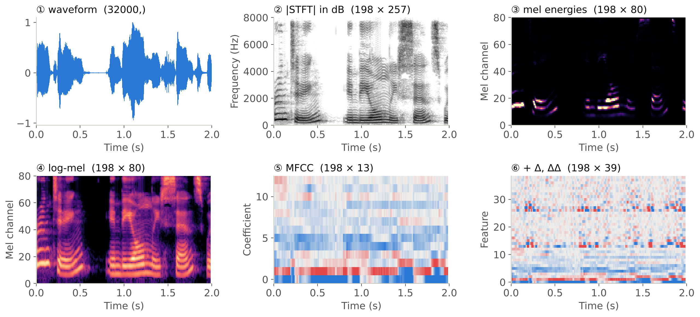

---
layout: section
title: The alignment problem
---

# Part 1

## The Alignment Problem

Frames vs. labels

---
layout: top-title
color: light
align: lt
title: Alignment
---

:: title ::

# Frames to Labels

:: content ::

- A 3 s sentence gives $T \approx 300$ frames but only about 40 phones. Nobody tells us **which frames belong to which phone**.
- An **alignment** gives every frame one label. It is **monotonic** (labels stay in order), **complete** (no frame left out) and **many-to-one** (a phone lasts one or more frames; typically 5–15).

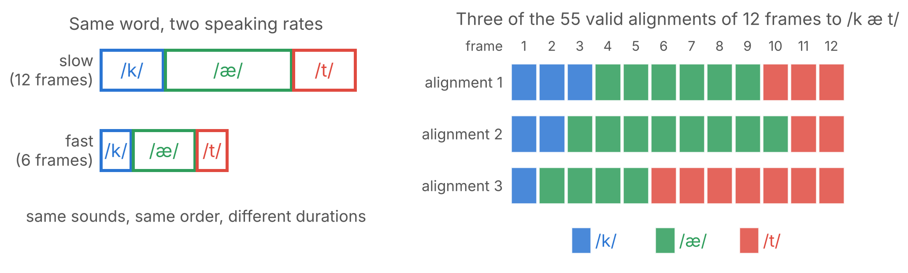

- Many alignments fit the same $X$ and $Y$, and the right one is **not observed**.

---
layout: top-title
color: amber-light
align: lt
title: Activity - say it slow
---

:: title ::

# Activity 1: Say It Slow, Say It Fast (10 min)

:: content ::

<div class="text-sm">

Open <a href="./spectrogram.html" target="_blank"><strong>Spectrogram Compare</strong></a>. A volunteer says **سلام** (*salaam*, /s a l aː m/).

1. **Record**: press <kbd>1</kbd>, say it at normal speed, press <kbd>Space</kbd>. Press <kbd>2</kbd> and say it **very slowly**. Both plates share one frame ruler (1 frame = 10 ms).
2. **Compare**: how many frames did each version take? Which sounds stretched the most?
3. **Align**: look at plate A. In Slido, type the **frame number where /l/ starts**.

</div>

<br/><br/><br/>

<v-click>

<div class="text-sm">

- The vowels stretch far more than the consonants. Same sounds, same order, different lengths.
- The answers for /l/ **spread over several frames**: the /l/→/a/ change is gradual, while /s/→/a/ is sharp. Even humans cannot agree on one alignment, so the model will **sum over all of them**.

</div>

</v-click>

<!--
Before class: start the deck with `slidev lecture4.md` and open the tool from this slide (it is served from lectures/public/spectrogram.html). The microphone only works on localhost or https. Allow the microphone once and test the room microphone.
Click a plate to mark a boundary (click it again to remove it); the segment lengths in frames appear under the plate. After the poll, click the two or three most common answers on plate A.
Backup: "Load example" shows a synthetic 'sa' at two speeds; "Open file" loads any WAV/MP3. "Save PNG" saves both plates for the course page.
-->

---
layout: section
title: Hidden Markov models
---

# Part 2

## Hidden Markov Models

States, transitions, emissions

---
layout: top-title
color: amber-light
align: lt
title: Activity - guess the switch
---

:: title ::

# Activity 2: Guess the Switch (10 min)

:: content ::

A volunteer behind the desk draws a slip on every clap and **says it out loud**. Listen, write down the 8 sounds, and guess **when the cup changed**.

<v-switch>
<template #0>
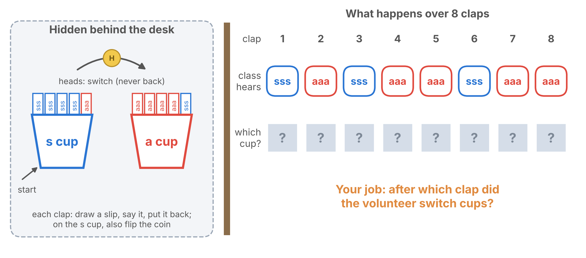
</template>
<template #1>
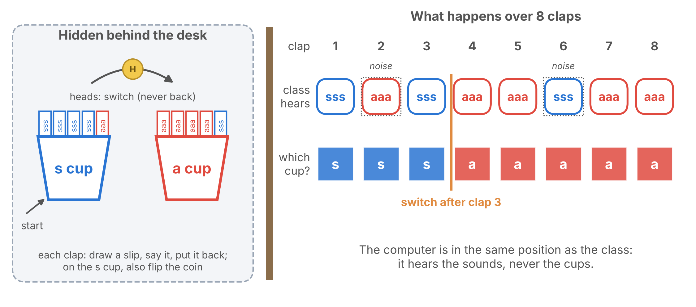
</template>
<template #2>


<div class="text-sm">

**In HMM terms**: the cup in use is the **hidden state**, the sounds are the **observations** $X$, the slips in each cup are the **emissions** $B$, the coin is the **transition** $A$, and starting with the s cup is $\pi$. We score exactly this game later.

</div>

</template>
</v-switch>

<!--
Kit: 2 paper cups, 10 slips, 1 coin. s cup: 4 slips "sss" + 1 slip "aaa". a cup: 4 slips "aaa" + 1 slip "sss".
Rules for the volunteer: start with the s cup. Each clap: draw a slip without looking, say it loudly, put it back, and secretly write "s" or "a" for the cup used. While still on the s cup, flip the coin after each clap: heads = switch to the a cup for the rest of the game.
After 8 claps, ask the class to vote with hands: "after which clap did the volunteer switch?" Then the volunteer shows their notes.
Click 1 shows an example answer (switch after clap 3, with two noisy slips). Click 2 gives the HMM vocabulary.
-->

---
layout: top-title
color: light
align: lt
title: From Markov chains to HMMs
---

:: title ::

# From Markov Chains to Hidden Markov Models

:: content ::

<v-switch>
<template #0>

**Step 1: a Markov chain.** If we could **see** the phone at every frame, the states and their transition probabilities would be the whole model. The probability of a state sequence is a product of transitions, and the alignment would already be known.

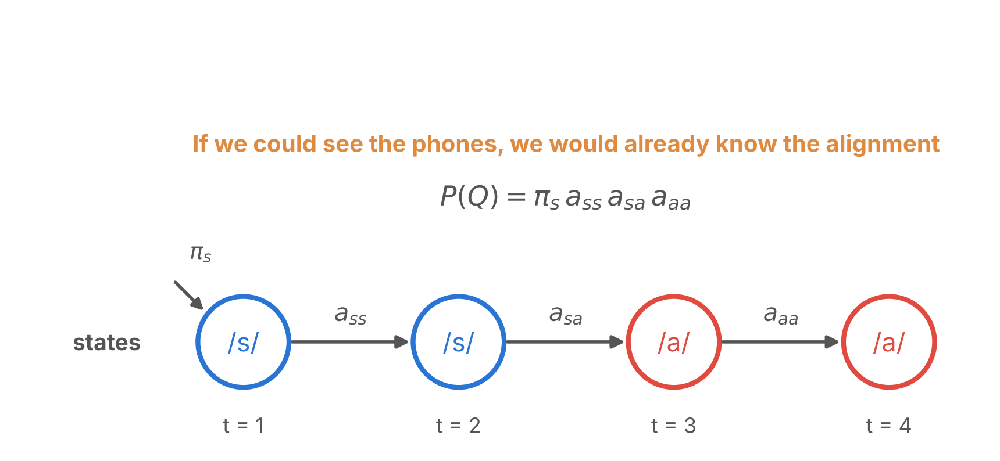

</template>
<template #1>

**Step 2: hide the states.** What the speaker intends (the phones) is hidden; what the microphone records (the frames) is observed. Two random processes run together: the hidden phones move forward by $A$, and each phone **emits** one frame by $B$.

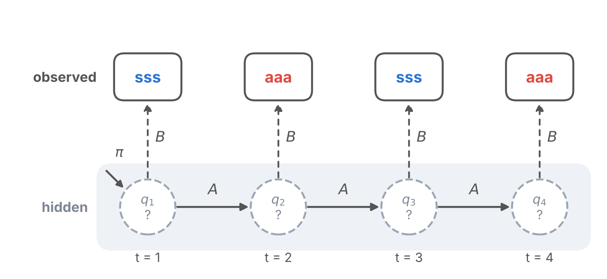

</template>
<template #2-4>

**Step 3: score one guess.** Pick a state sequence $Q$ (one alignment), then follow it: start ($\pi$), emit ($b$), move ($a$), emit ($b$), …

$$P(X, Q \mid \lambda) = \pi_{q_1}\, b_{q_1}(x_1) \prod_{t=2}^{T} a_{q_{t-1} q_t}\, b_{q_t}(x_t)$$

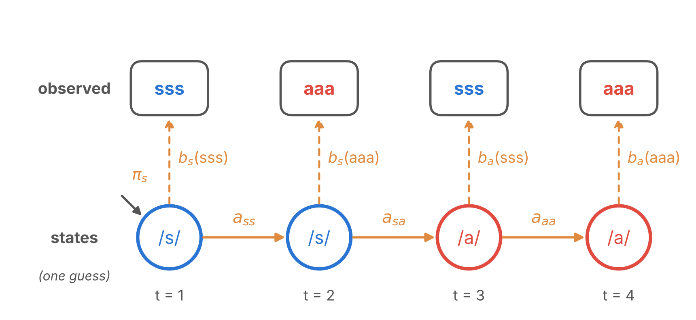

</template>
</v-switch>

<v-click at="3">

<div class="text-sm">

We never know $Q$, so we will **add this product over every possible $Q$**: that sum is $P(X \mid \lambda)$, and Part 3 shows how to compute it fast.

</div>

</v-click>

<!--
This slide condenses last year's build-up (source vs observed, observable Markov model, doubly stochastic process, direct computation of one path) into three clicks.
Step 1: with visible states there is nothing to infer. Step 2: the states become hidden; each one emits a frame. Step 3: the probability of one path is a product along it; the next click says we must sum over all paths.
-->

---
layout: top-title-two-cols
color: light
columns: is-6
align: l-lt-cm
title: HMM
---

:: title ::

# A Hidden Markov Model $\lambda = (\pi, A, B)$

:: left ::

<div class="text-sm">

- **States** $q_t$: here the phones /s/ and /a/ of *salaam*. They are **hidden**: we never see them.
- $\pi_j = P(q_1 = j)$: where we **start**. Here $\pi = (1, 0)$.
- $a_{ij} = P(q_t = j \mid q_{t-1} = i)$: **transitions**. Each row of $A$ sums to 1.
- **Observations** $x_t$: one symbol per frame. **h** = hiss ("sss": noise high in the spectrum), **v** = voiced ("aaa": strong low harmonics). The game's "sss aaa sss aaa" is $X = (h, v, h, v)$.
- $b_j(x_t) = P(x_t \mid q_t = j)$: **emissions**, the probability that state $j$ produces symbol $x_t$.

</div>

<AdmonitionType type='note'>
Real systems use 3 states per phone and a density over the full feature vector for <em>b</em><sub>j</sub>. 
</AdmonitionType>

:: right ::

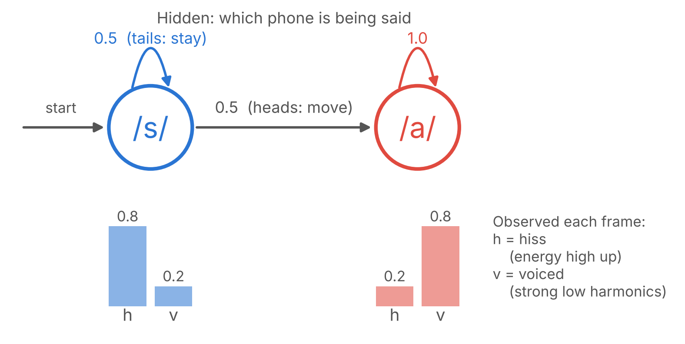


---
layout: top-title
color: light
align: lt
title: Assumptions
---

:: title ::

# The Two Assumptions

:: content ::

1. **Markov**: the next state depends only on the current one: $P(q_t \mid q_{1:t-1}) = P(q_t \mid q_{t-1})$.
2. **Output independence**: a frame depends only on the current state: $P(x_t \mid q_{1:T}, x_{1:t-1}) = P(x_t \mid q_t)$.

In the game both held by construction: the coin only looked at which cup was in use, and each slip only depended on that cup.

<v-click>

In real speech **both are wrong**:

- The next sound depends on much more than the current one (the word, the grammar, the speaking rate).
- Neighbouring frames are correlated even within one state: 25 ms windows overlap by 15 ms, coarticulation blends phones, and Δ features are built from neighbours.

They are kept because they make the **dynamic programming** of Part 3 possible.

</v-click>


---
layout: top-title
color: light
align: lt
title: Three problems
---

:: title ::

# HMM Problems

:: content ::

<div class="text-sm">

| Problem | Question | Algorithm |
|---|---|---|
| **1. Evaluation** | $P(X \mid \lambda)$: how likely is $X$ under the model? Sum over **all** alignments. | Forward | 
| **2. Decoding** | the **best** state sequence $\arg\max_Q P(Q, X \mid \lambda)$ | Viterbi | 
| **3. Learning** | $\arg\max_\lambda P(X \mid \lambda)$: fit the model to data | Baum–Welch (EM) | 

</div>

<AdmonitionType type='note'>
Reading: Rabiner (1989), <em>A Tutorial on Hidden Markov Models</em>.  CTC answers the same alignment problem by summing over alignments too, with the forward algorithm on a different graph.
</AdmonitionType>

---
layout: section
title: Forward algorithm
---

# Part 3

## The Forward Algorithm

Summing over every alignment at once

---
layout: top-title
color: amber-light
align: lt
title: Activity - count the alignments
---

:: title ::

# Activity 3: How Many Alignments? (3 min)

:: content ::

$$P(X \mid \lambda) = \sum_{\text{all } Q} P(X, Q \mid \lambda) = \sum_{q_1 \dots q_T} \pi_{q_1}\, b_{q_1}(x_1) \prod_{t=2}^{T} a_{q_{t-1} q_t}\, b_{q_t}(x_t)$$

**Poll**: a 3 s sentence has $T = 300$ frames and 40 phones × 3 states = **120 states**, visited in order. An alignment only says **at which frames we move on to the next state**. In the game there was 1 switch to guess; here there are 119. How many alignments? $\;10^{4}$, $10^{15}$, $10^{40}$ or $10^{86}$?

<v-click>

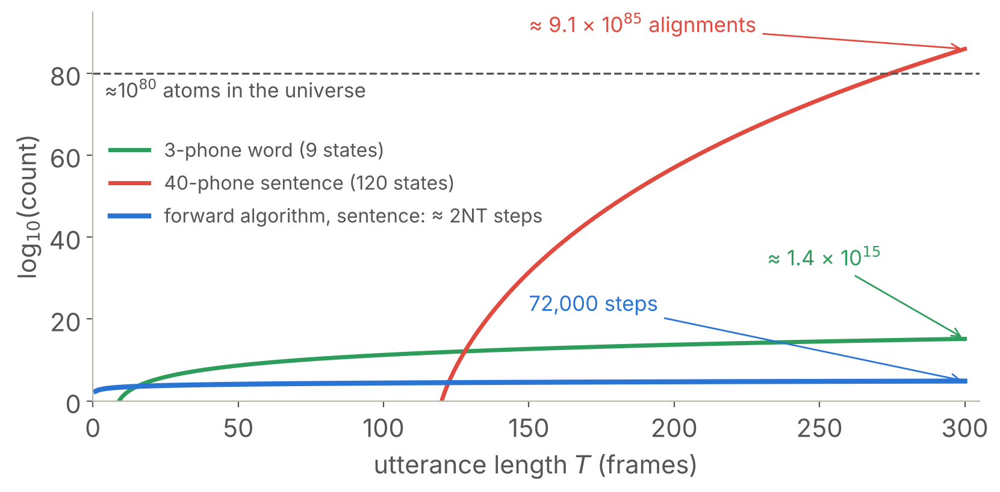

Choose the 119 switch points among the 299 gaps between frames: $\binom{299}{119} \approx 9.1 \times 10^{85}$, more than the atoms in the universe. The forward algorithm needs about **72,000** steps.

</v-click>

<!--
Slido poll 2 (multiple choice): 10^4, 10^15, 10^40, 10^86.
Counting: choose the 119 frame boundaries where the state changes, out of the 299 gaps between frames: C(299, 119). A single 3-phone word (9 states) already has C(299, 8) ≈ 1.4 × 10^15.
-->

---
layout: top-title
color: light
align: lt
title: Worked example
---

:: title ::

# Worked Example

:: content ::

<div class="text-sm">

| | |
|---|---|
| States and $\pi$ | /s/, /a/; start in /s/: $\pi = (1,\ 0)$ |
| $A$ | /s/→/s/ 0.5, /s/→/a/ 0.5, /a/→/a/ 1 |
| $B$ | /s/: $P(h) = 0.8$, $P(v) = 0.2$ · /a/: $P(h) = 0.2$, $P(v) = 0.8$ |
| Heard | the first 4 claps of the game: "sss aaa sss aaa", $X = (h, v, h, v)$ |

</div>

**Race (5 min)**: in pairs, list **every alignment** that ends in /a/ and multiply along each one, as in Step 3 of the HMM slide. Meanwhile I fill a **trellis** on the board, column by column, reusing the previous column. Do we get the same number?

<AdmonitionType type='important'>
Predict, then reveal: before each column, hold up a card: will /s/ or /a/ have the larger value?
</AdmonitionType>

<!--
The full game had 8 claps (7 possible switch points, so 7 alignments). We use only the first 4 claps so the trellis can be done by hand: 3 gaps, 3 alignments.
-->

---
layout: top-title
color: light
align: lt
title: Trellis
---

:: title ::

# Filling the Trellis

:: content ::

<v-switch>
<template #0>

Each circle holds the probability of **the sounds so far and being in this phone now**; we call it $\alpha_t(j)$.

**$t = 1$**: $\alpha_1(s) = 1 \cdot 0.8 = 0.8$, $\;\alpha_1(a) = 0 \cdot 0.2 = 0$: a word cannot start in /a/.

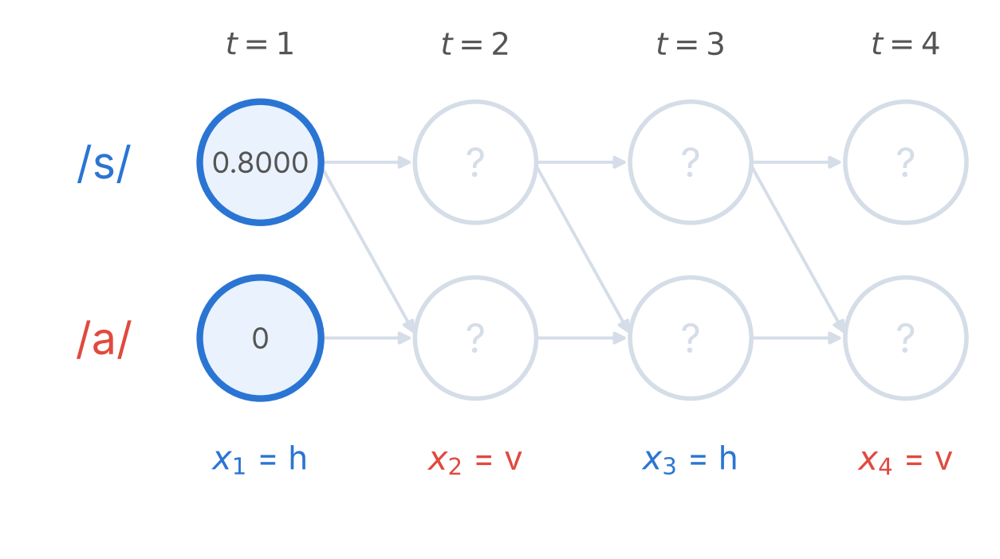

</template>
<template #1>

**$t = 2$** ($x_2 = v$): $\alpha_2(s) = 0.8 \cdot 0.5 \cdot 0.2 = 0.08$, $\;\alpha_2(a) = (0.8 \cdot 0.5 + 0 \cdot 1) \cdot 0.8 = 0.32$

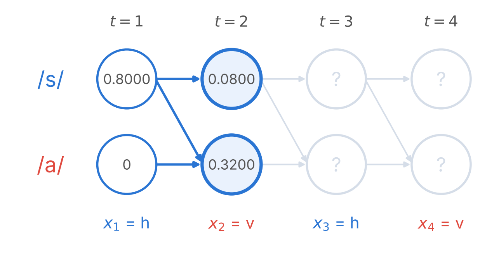

</template>
<template #2>

**$t = 3$** ($x_3 = h$, which favours /s/): $\alpha_3(s) = 0.08 \cdot 0.5 \cdot 0.8 = 0.032$, $\;\alpha_3(a) = (0.08 \cdot 0.5 + 0.32 \cdot 1) \cdot 0.2 = 0.072$

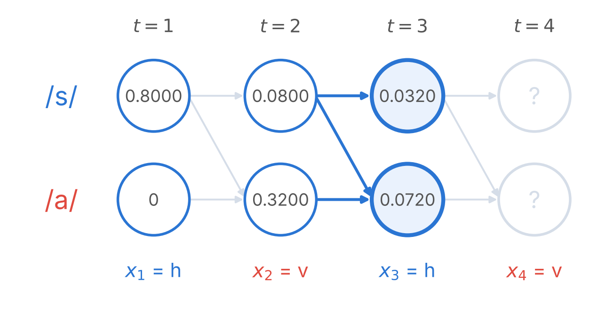

**Surprise**: /a/ still wins. Once in /a/ there is no way back, so this "sss" is most likely a stray slip from the /a/ cup.

</template>
<template #3>

**$t = 4$** ($x_4 = v$): $\alpha_4(s) = 0.032 \cdot 0.5 \cdot 0.2 = 0.0032$, $\;\alpha_4(a) = (0.032 \cdot 0.5 + 0.072 \cdot 1) \cdot 0.8 = 0.0704$

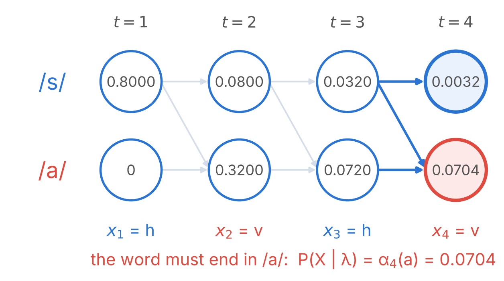

</template>
<template #4>

**Check against the race**: the three alignments that end in /a/:

<div class="text-sm">

| Alignment | Product along the path | Probability |
|---|---|---|
| s \| a a a | $0.8 \cdot 0.5 \cdot 0.8 \cdot 1 \cdot 0.2 \cdot 1 \cdot 0.8$ | 0.0512 |
| s s \| a a | $0.8 \cdot 0.5 \cdot 0.2 \cdot 0.5 \cdot 0.2 \cdot 1 \cdot 0.8$ | 0.0064 |
| s s s \| a | $0.8 \cdot 0.5 \cdot 0.2 \cdot 0.5 \cdot 0.8 \cdot 0.5 \cdot 0.8$ | 0.0128 |
| **Sum** | | **0.0704** $= \alpha_4(a)$ |

</div>

- The trellis adds up **all** alignments without listing them.
- The **best** single alignment (s | a a a) carries 73% of the total. Finding it with max instead of sum is Viterbi: next lecture.

</template>
</v-switch>

<!--
Click through 5 steps. Before t = 2 and t = 3, ask for the card vote.
-->

---
layout: top-title-two-cols
color: light
columns: is-7
align: l-lt-cm
title: Forward recursion
---

:: title ::

# The Forward Algorithm

:: left ::

<div class="text-sm">

**What we just did on the trellis, in general.** Many alignments share the same beginning, so each partial sum is computed **once** and reused.

$\alpha_t(j) = P(x_1, \dots, x_t,\; q_t = j \mid \lambda)$: the first $t$ frames **and** being in state $j$ at time $t$.

- **Initialize**: $\alpha_1(j) = \pi_j\, b_j(x_1)$
- **Recurse**: $\displaystyle \alpha_t(j) = \Big[\sum_{i=1}^{N} \alpha_{t-1}(i)\, a_{ij}\Big]\, b_j(x_t)$
- **Terminate**: $\displaystyle P(X \mid \lambda) = \sum_{j} \alpha_T(j)$. A word model must end in its **last** state, so we keep only $\alpha_T(N)$.

**Cost**: $N^2$ terms per frame, so $O(N^2 T)$ instead of listing every alignment. In a left-to-right model each state has at most 2 predecessors: about $2NT$.

</div>

:: right ::

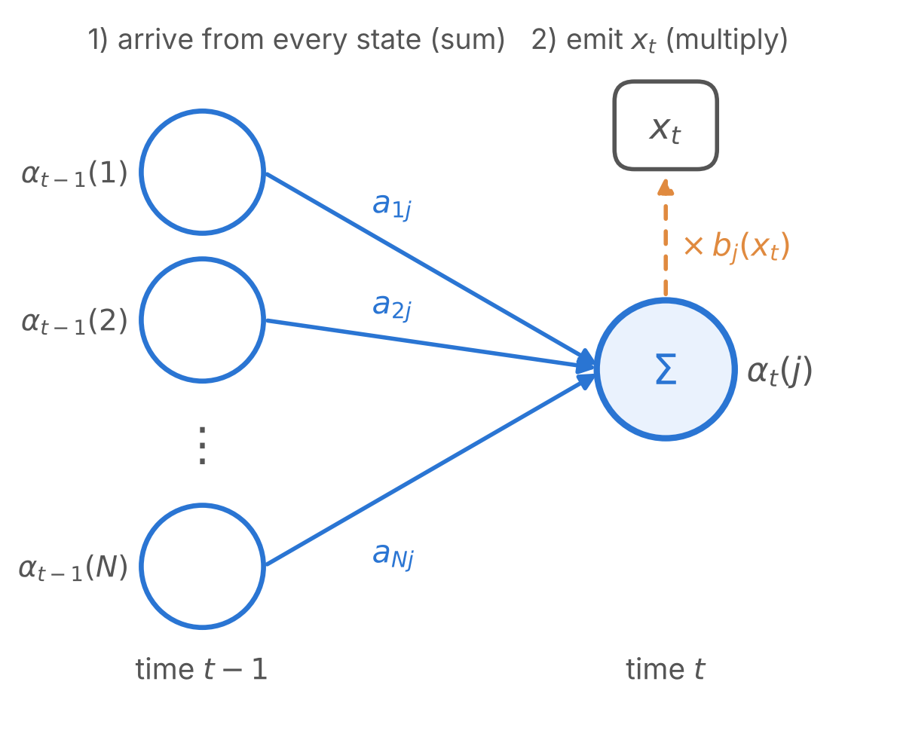

---
layout: top-title
color: amber-light
align: lt
title: Underflow
---

:: title ::

# Live Demo: Underflow

:: content ::

Every frame multiplies in more probabilities smaller than 1. Run this in Google Colab:

```python
import numpy as np
print(np.prod([0.01] * 300))   # 0.0: the true value is 1e-600, below the smallest float64 (~1e-308)
```

- Real utterances hit this quickly. So we work with **log** probabilities: products become sums, and the sum in the recursion becomes a **log-sum-exp**:

$$\log \alpha_t(j) = \log b_j(x_t) + \operatorname{logsumexp}_i\big(\log \alpha_{t-1}(i) + \log a_{ij}\big)$$

<AdmonitionType type='tip'>
<code>logsumexp</code> subtracts the largest term before exponentiating, so nothing underflows. CTC's loss (week 5) is computed the same way.
</AdmonitionType>

---
layout: top-title
color: amber-light
align: lt
title: Activity - bug hunt
---

:: title ::

# Activity 4: Bug Hunt (8 min)

:: content ::

One step of the recursion in NumPy (`alpha` is a vector over states, `A[i, j]` $= a_{ij}$, `B[state, symbol]`). **Only one is correct.** Vote in Slido, then explain your choice to a neighbour.

```python
alpha[t] = (alpha[t-1] @ A) * B[:, x[t]]                   # A
alpha[t] = (alpha[t-1][:, None] * A).max(0) * B[:, x[t]]   # B
alpha[t] = alpha[t-1] @ A                                  # C
alpha[t] = (A @ alpha[t-1]) * B[:, x[t]]                   # D
```

<v-click>

<div class="text-sm">

**A** is correct (0.0704). **B** keeps only the best predecessor: it returns 0.0512, the best single alignment (Viterbi). **C** never looks at the sounds. **D** uses $a_{ji}$: probability flows from /a/ back to /s/, so it never reaches /a/ and returns **0**.

</div>

</v-click>

<style>
.slidev-code { font-size: 1.1rem !important; line-height: 1.7 !important; }
</style>

<!--
Slido poll 3 (multiple choice): A, B, C, D. All four values were computed on the worked example.
-->

---
layout: top-title
color: light
align: lt
title: Check yourself
---

:: title ::

# Check Yourself

:: content ::

**1.** In the game, what played the role of $\pi$, $A$ and $B$?

<v-click>

$\pi$: starting with the s cup. $A$: the coin. $B$: the slips in each cup.

</v-click>

**2.** Why does the forward algorithm not need to list the alignments?

<v-click>

Alignments share beginnings. $\alpha_t(j)$ already holds the sum over every path that reaches state $j$ at time $t$, so each sum is done once.

</v-click>

**3.** A 3-phone word (9 states, left to right), $T = 300$: how many alignments, and about how many forward steps?

<v-click>

$\binom{299}{8} \approx 1.4 \times 10^{15}$ alignments vs. about $2NT = 5{,}400$ steps (or $N^2T = 24{,}300$ if every transition were allowed).

</v-click>

---
layout: top-title
color: light
align: lt
title: Summary
---

:: title ::

# What to Take Away

:: content ::

- Speech recognition is an **alignment problem**: hundreds of frames, a few dozen labels, and the boundaries are never given. Even people disagree on them.
- An **HMM** $(\pi, A, B)$ is a hidden state sequence that generates the frames. Its two assumptions are wrong for speech but make the computation tractable. Phones use **3 left-to-right states**, partly to get realistic durations.
- **Scoring** $P(X \mid \lambda)$ sums over **all** alignments. The **forward algorithm** does it in $O(N^2T)$ (about $2NT$ left to right) by reusing partial sums on a **trellis**, in log space.

Next lecture: the **best** alignment (Viterbi, forced alignment), and $b_j(x)$ for a real 39-dimensional MFCC vector (GMMs).

<AdmonitionType type='important'>
<strong>Project proposal</strong> is due this week. Reading: Rabiner (1989).
</AdmonitionType>

---
layout: top-title
color: sky-light
align: lt
title: Lab 4
---

:: title ::

# Assignment 4: The Forward Algorithm

:: content ::

1. **Implement** the forward algorithm in NumPy, in the **log domain**, for the *salaam* model from the slides. Reproduce the trellis: $\alpha_4(a) = 0.0704$ for $X = (h, v, h, v)$.
2. **Verify** with `hmmlearn.hmm.CategoricalHMM`. Its `score` sums over **all** end states ($\log 0.0736$), so compare it with $\sum_j \alpha_T(j)$.
3. **Brute force**: list all alignments for growing $T$, check that they sum to $\alpha_T(a)$, and time both methods.
4. **Extend**: give each phone 3 states and plot the duration distribution of /s/.

<AdmonitionType type='tip'>
Report the hardware you used and the wall-clock time for any timing experiment.
</AdmonitionType>

---
layout: section
title: Questions
class: text-center
---

# Learn More

[Course Homepage](https://github.com/m-fakhry/DSAI-456-Speech) · [Rabiner (1989): A Tutorial on Hidden Markov Models](https://ieeexplore.ieee.org/document/18626) · [J&M: Appendix A, Hidden Markov Models](https://web.stanford.edu/~jurafsky/slp3/A.pdf) · [hmmlearn](https://hmmlearn.readthedocs.io) · [Google Colab](https://colab.research.google.com)
