# Speech Recognition <br> (DSAI 456)
## Lecture 5: Viterbi and Gaussian Mixture Models

**Prof. Mohamed Ghalwash**
<Email v="mghalwash@zewailcity.edu.eg" />
_Zewail City University_

:: note ::

Lecture 5, Monday 26 October 2026.

---
layout: top-title
color: sky-light
align: lt
title: Today
---

:: title ::

# Agenda

:: content ::

**Objectives**: by the end of this lecture you should be able to find the best alignment with the Viterbi algorithm and explain how it differs from the forward algorithm, use Viterbi for forced alignment, explain how a Gaussian mixture scores a continuous feature vector, fit a mixture with EM, and describe how GMMs and HMMs are trained together.

- **Viterbi**: the best alignment instead of all of them
- **Gaussian mixture models**: where $b_j(x_t)$ comes from
- **Putting it together**: training a GMM-HMM, and its limits

---
layout: section
title: Viterbi
---

# Part 1

## The Viterbi Algorithm

The best alignment instead of all of them

---
layout: top-title
color: light
align: lt
title: Which alignment
---

:: title ::

# From "How Likely?" to "Which One?"

:: content ::

The race from earlier today listed the three alignments of *salaam* that end in /a/:

<div class="text-sm">

| Alignment | Probability |
|---|---|
| **s \| a a a** | **0.0512** |
| s s \| a a | 0.0064 |
| s s s \| a | 0.0128 |
| Sum $= \alpha_4(a)$ (forward) | 0.0704 |

</div>

<v-click>

- Forward tells us **how likely** the word is. To **transcribe**, or to find **where each phone is**, we need the top row: the single **best** alignment.

</v-click>

<v-click>

- Listing is hopeless ($10^{86}$ alignments for one sentence). Idea: in each trellis cell, **keep only the best incoming path** and **remember where it came from**. Is that safe?

</v-click>

---
layout: top-title
color: amber-light
align: lt
title: Activity - road trip
---

:: title ::

# Activity 1: The Fastest Route to Luxor (3 min)

:: content ::

<v-switch>
<template #0>

<div class="grid grid-cols-[3fr_2fr] gap-6 items-start">
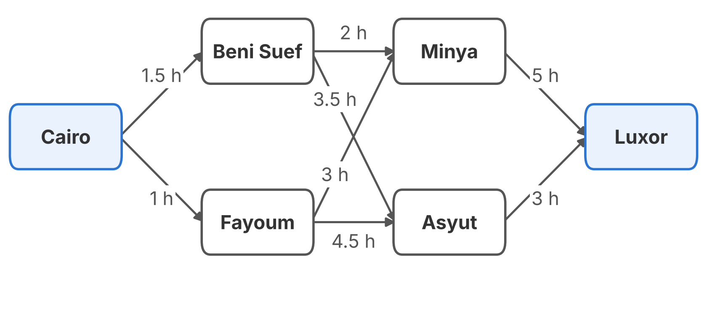
<div class="text-sm">

Travel times in hours (invented). Find the **fastest** route from Cairo to Luxor.

**Rule**: each city may hold **one number only**: the fastest time to reach it so far. Work from left to right.

</div>
</div>

</template>
<template #1>

<div class="grid grid-cols-[3fr_2fr] gap-6 items-start">
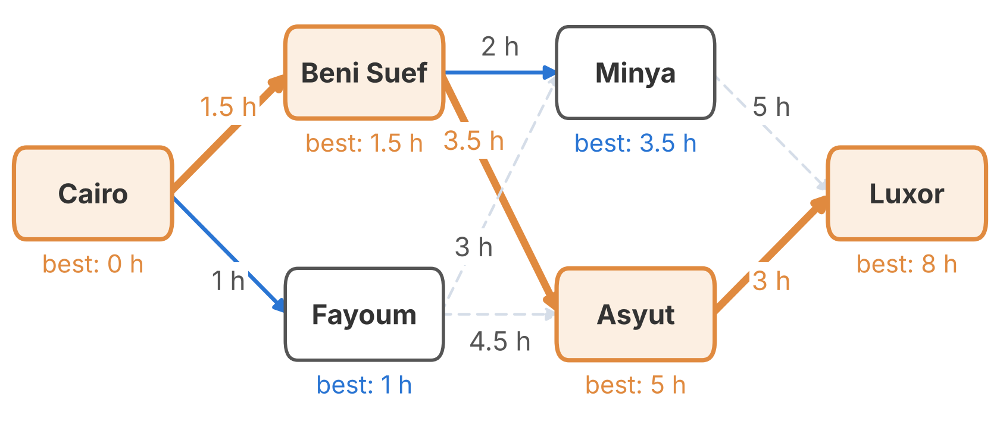
<div class="text-sm">

**8 h**, via Beni Suef and Asyut. Minya keeps only its best arrival (3.5 h) and forgets the slower one (4 h).

A **greedy** driver, who always takes the fastest next road, goes via Fayoum and Minya: **9 h**.

</div>
</div>

</template>
<template #2>

<div class="grid grid-cols-[3fr_2fr] gap-6 items-start">

<div class="text-xs">

**This is Viterbi.**

| Road trip | Viterbi |
|---|---|
| city | state |
| column of cities | frame $t$ |
| hours | $-\log$ probability |
| fastest | most likely |
| best time at a city | $\delta_t(j)$ |
| where you came from | $\psi_t(j)$ |

**Why is forgetting safe?** If the fastest trip to Luxor passes through Asyut, its first part must be the fastest way to Asyut. Otherwise, swap in the faster one and the whole trip gets faster.

</div>
</div>

</template>
</v-switch>

---
layout: top-title-two-cols
color: light
columns: is-7
align: l-lt-ct
title: Viterbi algorithm
---

:: title ::

# The Viterbi Algorithm

:: left ::

<div class="text-sm">

**The road trip, in general.** $\delta_t(j)$ is the probability of the **best** path that explains $x_1, \dots, x_t$ and ends in state $j$ at time $t$.

<v-clicks>

- **Initialize**: $\delta_1(j) = \pi_j\, b_j(x_1)$ <span class="text-gray-400">· start: Cairo, 0 h</span>
- **Recurse**: $\displaystyle \delta_t(j) = \Big[\max_{i} \delta_{t-1}(i)\, a_{ij}\Big]\, b_j(x_t)$ <span class="text-gray-400">· Minya: min(1.5 + 2, 1 + 3) = 3.5 h</span>
- **Remember**: $\psi_t(j) = \arg\max_i\ \delta_{t-1}(i)\, a_{ij}$ <span class="text-gray-400">· Minya came from Beni Suef</span>
- **Terminate**: $P^* = \delta_T(N)$, since a word must end in its last state <span class="text-gray-400">· the goal is fixed: Luxor, 8 h</span>
- **Backtrace**: $q_t^* = \psi_{t+1}(q_{t+1}^*)$ for $t = T-1, \dots, 1$ <span class="text-gray-400">· Luxor ← Asyut ← Beni Suef ← Cairo</span>
- **Cost**: $O(N^2T)$, like forward. In log space max stays max, so no logsumexp is needed: $\log \delta_t(j) = \log b_j(x_t) + \max_i\big(\log \delta_{t-1}(i) + \log a_{ij}\big)$

</v-clicks>

</div>

:: right ::

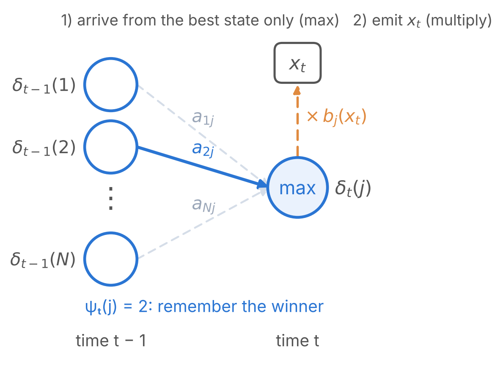

<AdmonitionType type='note'>
In ASR the best path gives two things at once: <strong>decoding</strong> (which words) and <strong>alignment</strong> (which frames belong to which phone).
</AdmonitionType>

---
layout: top-title
color: amber-light
align: lt
title: Activity - Viterbi by hand
---

:: title ::

# Activity 2: Viterbi by Hand (8 min)

:: content ::

<div class="text-sm">

Same *salaam* model, same $X = (h, v, h, v)$. Fill the trellis with **max instead of sum**, and draw an arrow from each cell to the predecessor that won.

</div>

<v-switch>
<template #0>

<div class="h-12 text-sm">

**$t = 1$**: nothing to choose yet: $\delta_1(s) = 1 \cdot 0.8 = 0.8$, $\;\delta_1(a) = 0$.

</div>

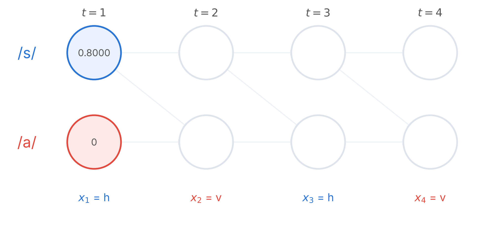

<div class="h-10 text-sm">


</div>

</template>
<template #1>

<div class="h-12 text-sm">

**$t = 2$** ($x_2 = v$): $\delta_2(s) = 0.8 \cdot 0.5 \cdot 0.2 = 0.08$, $\;\delta_2(a) = \max(0.8 \cdot 0.5,\ 0 \cdot 1) \cdot 0.8 = 0.32$, from /s/.

</div>

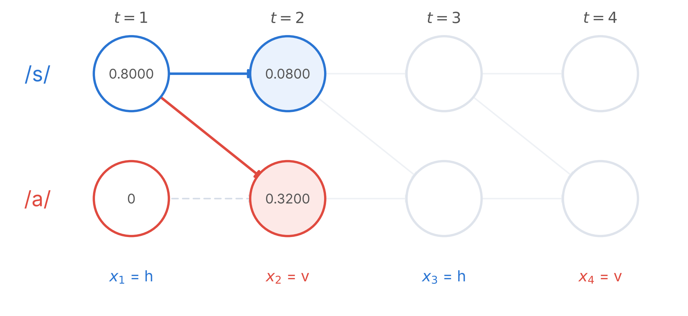

<div class="h-10 text-sm">

Same as $\alpha_2$: /a/ had only one real way in.

</div>

</template>
<template #2>

<div class="h-12 text-sm">

**Shortcut?** Pick each frame’s best emission on its own: h → /s/, v → /a/. That gives **s a s a**. **Hands up**: is that a possible path?

</div>

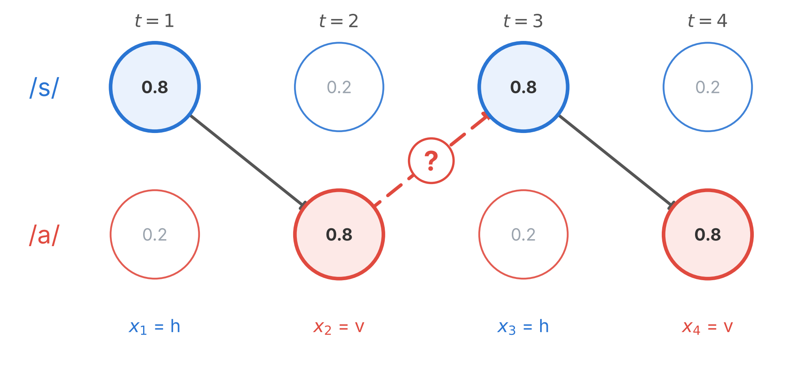

<div class="h-10 text-sm">

The circles show only the emission probabilities $b_j(x_t)$.

</div>

</template>
<template #3>

<div class="h-12 text-sm">

**No.** s a s a needs a jump from /a/ back to /s/, and that transition has probability 0.

</div>

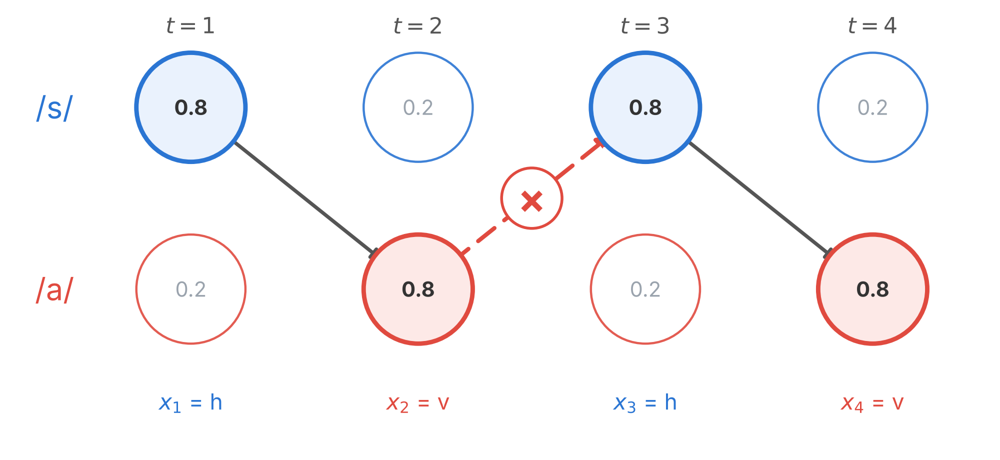

<div class="h-10 text-sm">

Looking at one frame at a time ignores the transitions. Viterbi uses both.

</div>

</template>
<template #4>

<div class="h-12 text-sm">

**$t = 3$** ($x_3 = h$): $\delta_3(s) = 0.032$, $\;\delta_3(a) = \max(0.08 \cdot 0.5,\ 0.32 \cdot 1) \cdot 0.2 = 0.064$, from /a/.

</div>

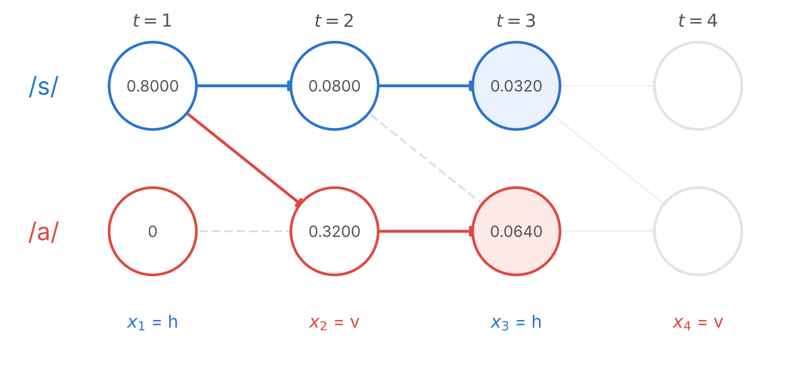

<div class="h-10 text-sm">

The h favours /s/, but the best path stays in /a/ ($0.064 > 0.032$). Forward added both arrows into /a/ ($\alpha_3(a) = 0.072$); Viterbi keeps the larger.

</div>

</template>
<template #5>

<div class="h-12 text-sm">

**$t = 4$** ($x_4 = v$): $\delta_4(s) = 0.0032$, $\;\delta_4(a) = \max(0.032 \cdot 0.5,\ 0.064 \cdot 1) \cdot 0.8 = 0.0512$, from /a/.

</div>

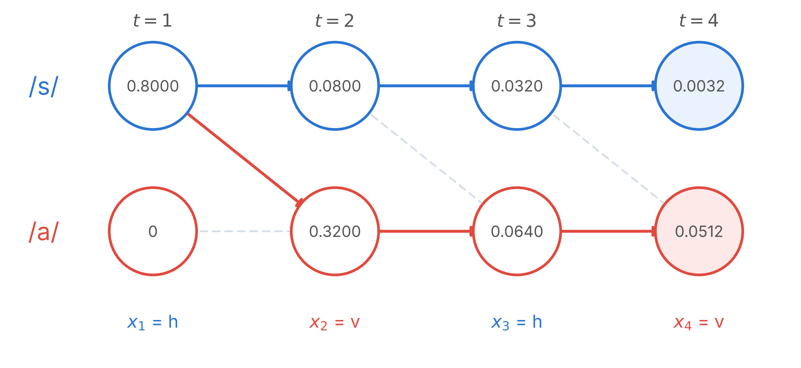

<div class="h-10 text-sm">

Solid arrow: the winning predecessor. Dashed: the loser.

</div>

</template>
<template #6>

<div class="h-12 text-sm">

**Backtrace**: the word must end in /a/, so start at $\delta_4(a)$ and follow the arrows back: $\psi_4(a) = a$, $\psi_3(a) = a$, $\psi_2(a) = s$.

</div>

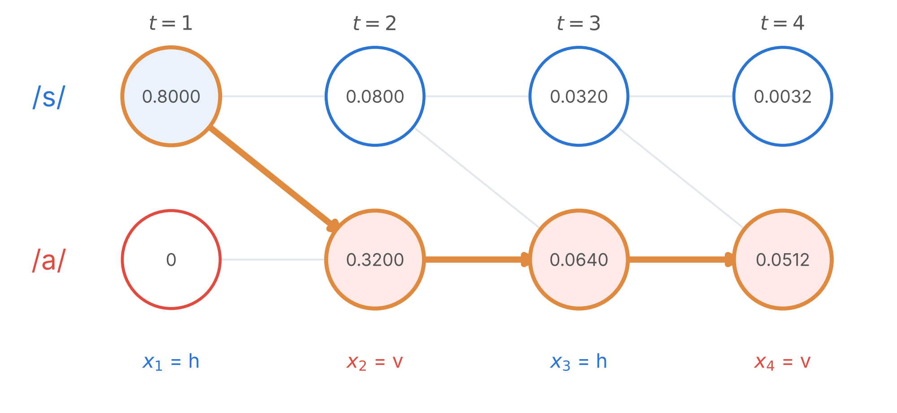

<div class="h-10 text-sm">

The answer is **s | a a a** with $P^* = 0.0512$: the top row of the race table, found without listing anything.

</div>

</template>
</v-switch>


---
layout: top-title
color: amber-light
align: lt
title: Activity - bug hunt
---

:: title ::

# Activity 3: Bug Hunt (5 min)

:: content ::

<div class="text-sm">

`delta[t, j]` and `psi[t, j]` (the best predecessor of state `j` at time `t`) are filled for *salaam*. States: 0 = /s/, 1 = /a/; the word ends in the last state, `N - 1`. **Only one backtrace is correct.** Vote in Slido.

</div>

<div class="grid grid-cols-2 gap-x-6">
<div>

```python
# A
path = [N - 1]
for t in range(T - 1, 0, -1):
    path.insert(0, psi[t, path[0]])
```

</div>
<div>

```python
# B
path = [N - 1]
for t in range(T - 1, 0, -1):
    path.insert(0, psi[t - 1, path[0]])
```

</div>
<div>

```python
# C
path = [B[:, x[t]].argmax()
        for t in range(T)]
```

</div>
<div>

```python
# D
path = [0]
for t in range(1, T):
    path.append(psi[t, path[-1]])
```

</div>
</div>

<v-click>

<div class="text-sm">

**A** is correct: s a a a (0.0512). **B** reads ψ one column too early and returns s s a a, a real path (0.0064), so the bug hides. **C** ignores the transitions: s a s a, the greedy trap (probability 0). **D** follows the arrows forwards from /s/: s s s s, which never reaches /a/.

</div>

</v-click>

<style>
.slidev-code { font-size: 0.95rem !important; line-height: 1.5 !important; }
</style>

---
layout: top-title
color: light
align: lt
title: Sum vs max
---

:: title ::

# Sum vs. Max on *salaam*

:: content ::

<div class="text-sm">

| $t$ | $\alpha_t(s)$ | $\delta_t(s)$ | $\alpha_t(a)$ | $\delta_t(a)$ |
|---|---|---|---|---|
| 1 | 0.8 | 0.8 | 0 | 0 |
| 2 | 0.08 | 0.08 | 0.32 | 0.32 |
| 3 | 0.032 | 0.032 | 0.072 | 0.064 |
| 4 | 0.0032 | 0.0032 | **0.0704** | **0.0512** |

</div>

- Each $\delta$ is **one term** of the sum that makes $\alpha$, so $\delta_t(j) \le \alpha_t(j)$. They are equal while only one path has non-zero probability.
- Here the best path carries $0.0512 / 0.0704 = 73\%$ of the total.

---
layout: top-title
color: amber-light
align: lt
title: Activity - do they agree
---

:: title ::

# Activity 4: Best Path or Total? (4 min)

:: content ::

<div class="text-sm">

Neither algorithm picks a word: each one gives a word a **score**. To recognize a word, we score the audio with **every word's HMM** and keep the highest score. Which score: the **total** over all alignments, $P(X \mid \text{word})$ (forward), or the **best** alignment only, $P^*$ (Viterbi)?

Word A has **one** alignment, with probability 0.010. Word B has **ten** alignments, with 0.002 each. **Poll**: which word wins with each score?

</div>

<v-click>

<div class="grid grid-cols-2 gap-6 items-center">
<div>

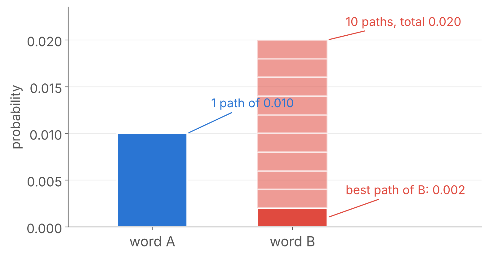

</div>
<div class="text-sm">

| Score | Word A | Word B | Winner |
|---|---|---|---|
| Best path (Viterbi) | **0.010** | 0.002 | **A** |
| Total (forward) | 0.010 | **0.020** | **B** |

The two scores **rank the words differently** when one word spreads its probability over many alignments. The total is the true $P(X \mid \text{word})$; the best path is a fast stand-in that usually ranks the same way (73% of the total on *salaam*).

</div>
</div>

</v-click>

<v-click>

<div class="text-sm">

**Try it** in <a href="./trellis.html#sum-max" target="_blank"><strong>Trellis Lab</strong></a>: find two words that the two scores rank differently.

</div>

</v-click>

---
layout: top-title
color: light
align: lt
title: Forced alignment
---

:: title ::

# Forced Alignment

:: content ::

When the transcript is **known**, Viterbi tells us **where** each phone is.

1. Build one long left-to-right HMM for the sentence: words → phones (lexicon) → 3 states per phone.
2. Run Viterbi over the whole utterance.
3. Read the best path: every frame gets a phone, and every phone gets a start and end frame.

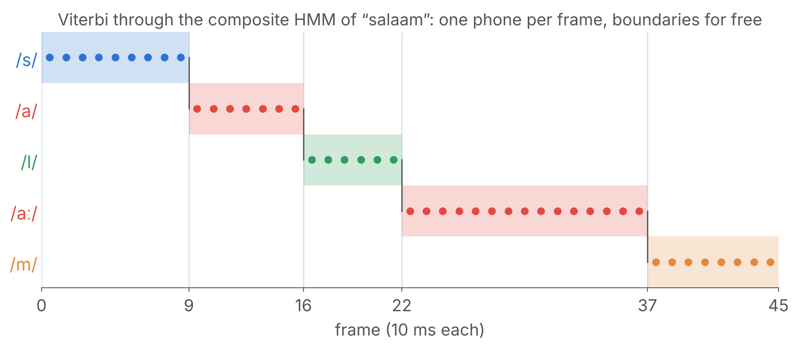

<div class="text-sm">

Last week we disagreed on where /l/ starts; Viterbi commits to **one** answer. These frame labels are what a neural frame classifier will need for training.

</div>

---
layout: section
title: Gaussian mixture models
---

# Part 2

## Gaussian Mixture Models

Where $b_j(x_t)$ comes from

---
layout: top-title-two-cols
color: light
columns: is-6
align: l-lt-cm
title: Symbols to vectors
---

:: title ::

# From Symbols to Vectors

:: left ::

<div class="text-sm">

- In the *salaam* model, $B$ was a **table**: /s/ emits h with probability 0.8.
- A real frame is a vector of **39 real numbers** (13 MFCC + Δ + ΔΔ). A table cannot list every possible vector, so $b_j(x_t)$ must be a **density**: a function that scores any vector. (A density can be larger than 1; it is not a probability.)
- We build it in steps, starting with **one** feature we already know: F1, the first formant (Lecture 2). F1 is not one of the 39, but it is easy to picture, and each coefficient works the same way.

**Question**: a new frame has F1 = 700 Hz. Does it look like /a/? How much?

</div>

:: right ::

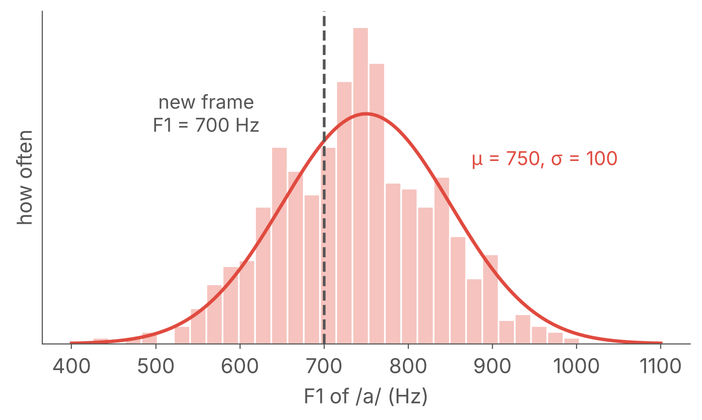

---
layout: top-title
color: light
align: lt
title: Gaussian
---

:: title ::

# One Bump: the Gaussian

:: content ::

A bell curve needs only a centre $\mu$ and a width $\sigma$:

$$\mathcal{N}(x;\mu,\sigma) = \frac{1}{\sqrt{2\pi}\,\sigma}\, \exp\!\Big(-\frac{z^2}{2}\Big), \qquad z = \frac{x-\mu}{\sigma}$$

<div class="text-sm">

| Piece | What it does |
|---|---|
| $z = (x - \mu)/\sigma$ | how many **σ-widths** $x$ is from the centre |
| $\exp(-z^2/2)$ | turns that distance into a score: 1 at the centre, falling fast |
| $1/(\sqrt{2\pi}\,\sigma)$ | makes the area under the curve equal 1 |

</div>

---
layout: top-title
color: amber-light
align: lt
title: Activity - which vowel
---

:: title ::

# Activity 5: Which Vowel? (3 min)

:: content ::

**Poll**: /i/ has $\mu = 300$ Hz, $\sigma = 50$ Hz. /a/ has $\mu = 750$ Hz, $\sigma = 100$ Hz. A frame has F1 = **500 Hz**. Which vowel fits better? (Hint: 500 is closer to /i/ in Hz.)

<v-click>

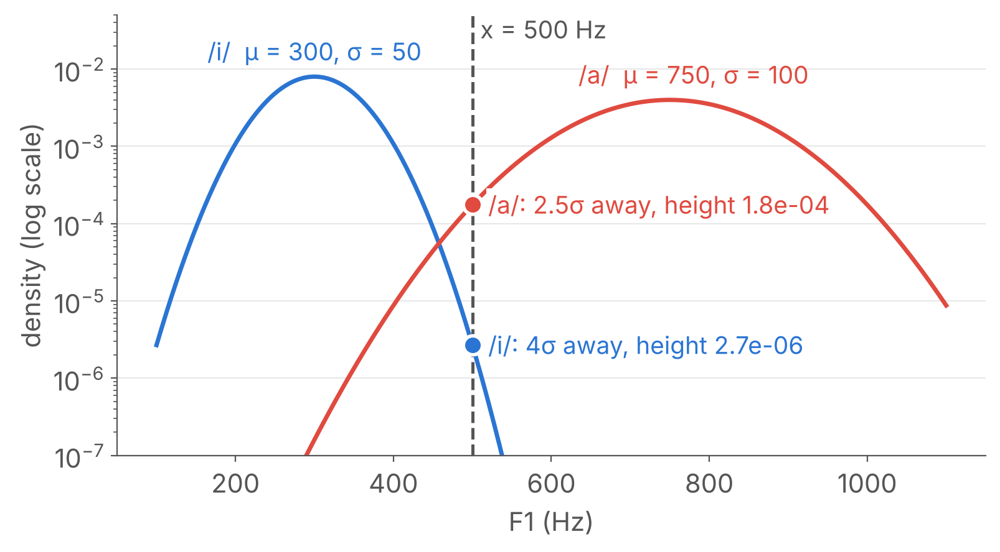

<div class="text-sm">

/i/: $(500 - 300)/50 = 4\sigma$ away, height $\approx 2.7 \times 10^{-6}$. &nbsp; /a/: $(500 - 750)/100 = -2.5\sigma$ away, height $\approx 1.8 \times 10^{-4}$, about **65 times higher**. **/a/ wins**: distance is measured in σ, not in Hz.

</div>

</v-click>

---
layout: top-title
color: light
align: lt
title: One bump
---

:: title ::

# One Bump Is Not Enough

:: content ::

The same vowel /a/, from adult men (~730 Hz) and children (~1030 Hz), makes **two bumps**.

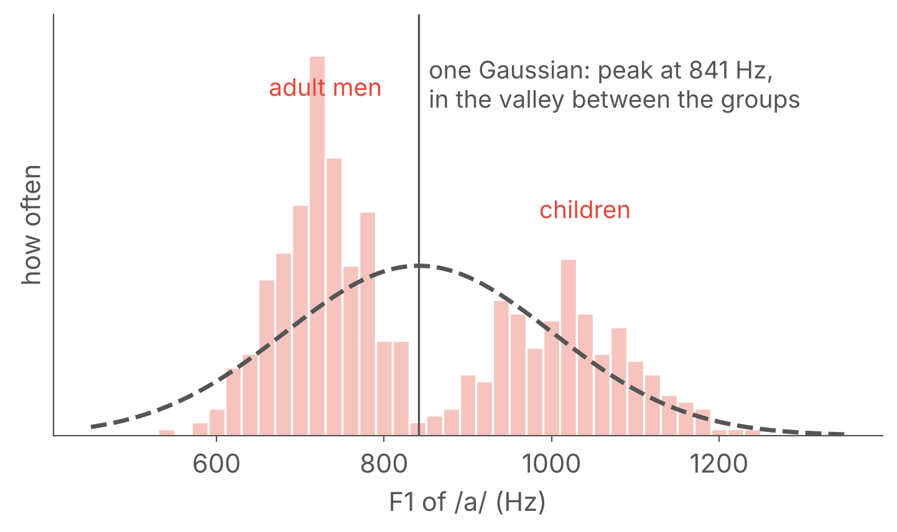

One Gaussian puts its peak **in the valley**, where there is almost no data, and scores real /a/ frames poorly.

---
layout: top-title
color: light
align: lt
title: Mixture
---

:: title ::

# A Mixture of Bumps

:: content ::

The fix is to **add** bumps, each with a weight:

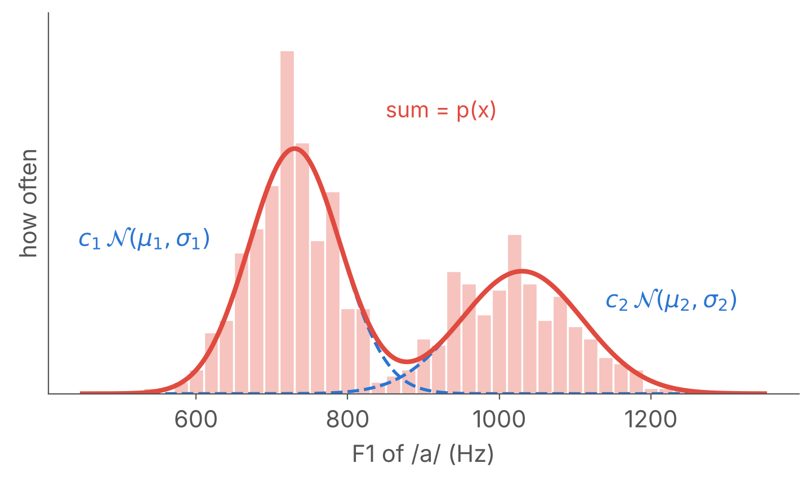

$$p(x) = \sum_{m=1}^{M} c_m\, \mathcal{N}(x;\mu_m,\sigma_m), \qquad \sum_m c_m = 1$$

<v-click>

<div class="text-sm">

**The story behind it**: flip a weighted coin to pick a group (the weights $c_m$ say how common each group is), then draw $x$ from that group's bump. This is a **Gaussian mixture model** (GMM).

</div>

</v-click>

---
layout: top-title
color: light
align: lt
title: Fitting one bump
---

:: title ::

# Fitting One Bump Is Easy

:: content ::

If all the points $x_1, \dots, x_T$ come from **one** bump, fitting it means two averages:

$$\mu = \frac{1}{T}\sum_{t} x_t \qquad\qquad \sigma^2 = \frac{1}{T}\sum_t (x_t - \mu)^2$$

- $\mu$: the **average** of the points.
- $\sigma^2$: the **average squared distance** from $\mu$.

<v-click>

With **two** bumps, the question is: which points do we average for which bump?

</v-click>

---
layout: top-title
color: light
align: lt
title: Who belongs where
---

:: title ::

# Two Bumps: Who Belongs Where?

:: content ::

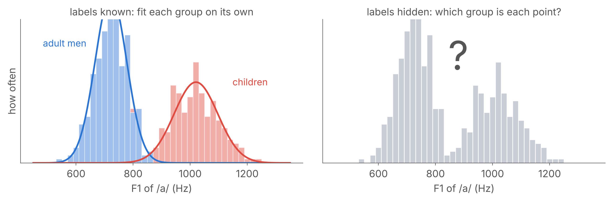

- **Left**: if every point had a label (man or child), we would fit each bump on its own points, exactly as on the previous slide.
- **Right**: in real data the labels are **hidden**. Nobody tells us which group a frame came from.

---
layout: top-title
color: sky-light
align: lt
title: Lab 5
---

:: title ::

# Assignment 5: Viterbi and GMMs

:: content ::

<div class="text-sm">

1. **Implement** Viterbi in NumPy, in the **log domain**, for the *salaam* model. Reproduce $\delta_4(a) = 0.0512$ and the path s | a a a.
2. **Verify** with `hmmlearn.hmm.CategoricalHMM.decode(..., algorithm="viterbi")`, and against brute force by listing every alignment. Would brute force catch bug B from Activity 3?

</div>

<AdmonitionType type='tip'>
Report the hardware you used and the wall-clock time for any timing or fitting experiment.
</AdmonitionType>

---
layout: section
title: Questions
class: text-center
---

# Learn More

[Course Homepage](https://github.com/m-fakhry/DSAI-456-Speech) · [Rabiner (1989): A Tutorial on Hidden Markov Models](https://ieeexplore.ieee.org/document/18626) · [J&M: Appendix A, Hidden Markov Models](https://web.stanford.edu/~jurafsky/slp3/A.pdf) · [scikit-learn: Gaussian mixture models](https://scikit-learn.org/stable/modules/mixture.html) · [Montreal Forced Aligner](https://montreal-forced-aligner.readthedocs.io) · [hmmlearn](https://hmmlearn.readthedocs.io)
