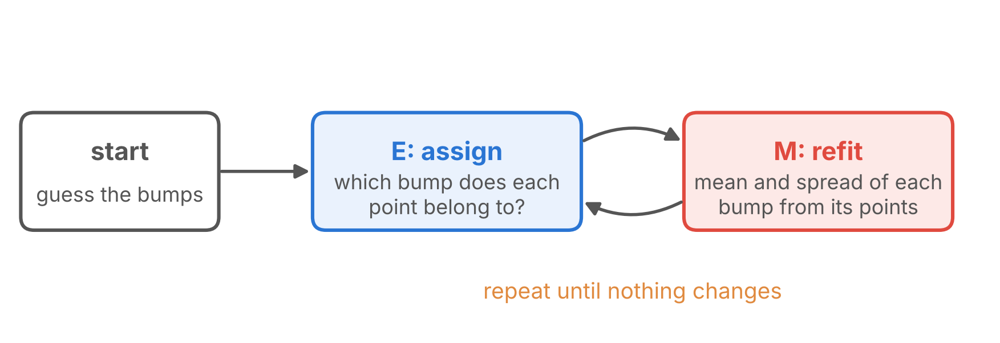
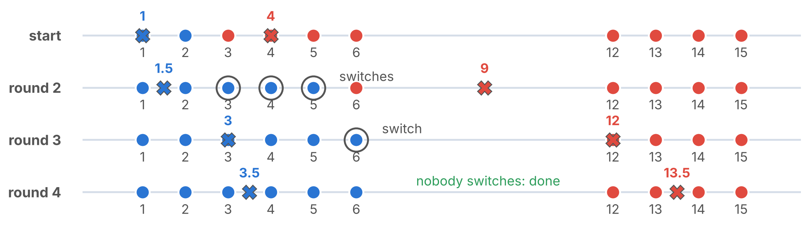
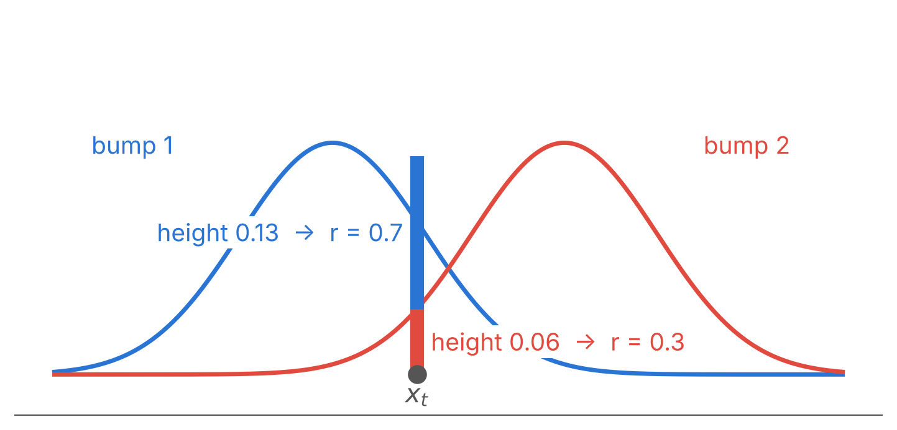
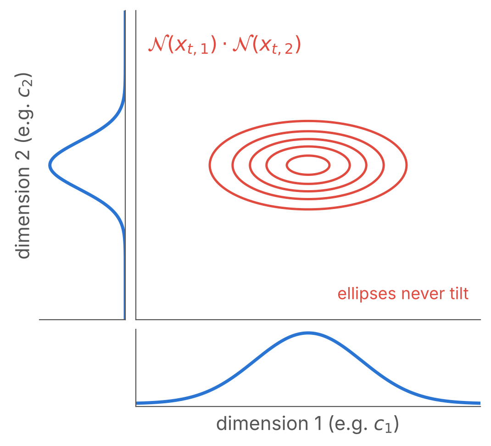
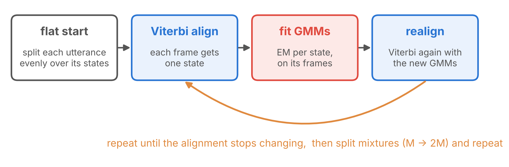
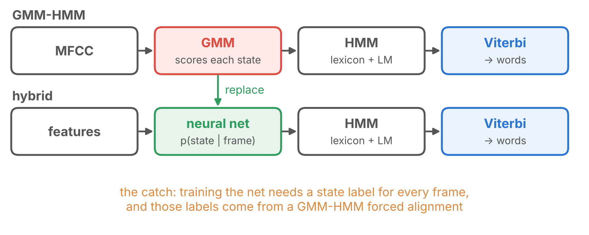

:: title ::

# Chicken and Egg: the EM Idea

:: content ::

<v-clicks>

- If we knew **which bump each point came from**, we could fit the bumps.
- If we knew **the bumps**, we could tell which bump each point most likely came from.
- We know **neither**. So we **guess** the bumps and then **alternate**:

</v-clicks>

<v-click>

This loop is the **EM** algorithm: **E**xpectation (assign), **M**aximization (refit).

</v-click>

<v-click>

<AdmonitionType type='important'>
Keep this idea in mind: we will meet the same chicken-and-egg problem again.
</AdmonitionType>

</v-click>

---
layout: top-title
color: amber-light
align: lt
title: Activity - human k-means
---

:: title ::

# Activity 6: Human k-means (6 min)

:: content ::

Ten volunteers hold the cards **1 2 3 4 5 6 12 13 14 15** and stand under their number on the board. Two more volunteers are the **centres**: blue starts at **1**, red at **4**. Then repeat until nobody switches:

1. **Assign**: every card-holder joins the **nearer** centre.
2. **Update**: each group calls out its **average**, and its centre walks there.

<v-click>

Cards 3, 4 and 5 switch in round 2, card **6** switches last, and the centres stop at **3.5** and **13.5**. This is **k-means**: hard EM, where every card belongs 100% to one group.

</v-click>

---
layout: top-title
color: light
align: lt
title: E-step
---

:: title ::

# EM, Soft Version: the E-step

:: content ::

In Activity 6, card 6 had to join **one** group. The soft version **shares** each point between the bumps, in proportion to their heights at that point:

<v-click>

$$r_{tm} = \frac{c_m\, \mathcal{N}(x_t;\mu_m,\sigma_m)}{\sum_k c_k\, \mathcal{N}(x_t;\mu_k,\sigma_k)} \qquad \text{here: } \frac{0.13}{0.13 + 0.06} \approx 0.7$$

$r_{tm}$ is the **responsibility** of bump $m$ for point $x_t$; the shares of each point sum to 1. Watch EM run in <a href="./trellis.html#em" target="_blank"><strong>Trellis Lab</strong></a>.

</v-click>

---
layout: top-title
color: light
align: lt
title: M-step
---

:: title ::

# EM, Soft Version: the M-step

:: content ::

The same two averages as for one bump, but every point now counts with its share $r_{tm}$ instead of 0 or 1:

<v-clicks>

- **Centre**: $\displaystyle \mu_m = \frac{\sum_t r_{tm}\, x_t}{\sum_t r_{tm}}$, the weighted average of the points.
- **Spread**: $\displaystyle \sigma_m^2 = \frac{\sum_t r_{tm}\,(x_t - \mu_m)^2}{\sum_t r_{tm}}$, the weighted average squared distance.
- **Weight**: $\displaystyle c_m = \frac{1}{T}\sum_t r_{tm}$, the share of all the points that bump $m$ takes.

</v-clicks>

<v-click>

<AdmonitionType type='tip'>
If every share is exactly 0 or 1, the centre update is exactly what the human k-means did in Activity 6.
</AdmonitionType>

</v-click>

---
layout: top-title-two-cols
color: light
columns: is-6
align: l-lt-cm
title: 39 dimensions
---

:: title ::

# From 1 Feature to 39

:: left ::

A real frame has **39 numbers**, not one.

<v-clicks>

- Simplest assumption: **inside each bump**, the 39 numbers are **independent**.
- Then each 39-D bump is just a **product** of 39 one-dimensional Gaussians, each with its own $\mu_d$ and $\sigma_d$:

$$\mathcal{N}(x_t) = \prod_{d=1}^{39} \mathcal{N}(x_{t,d};\ \mu_d, \sigma_d)$$

- Per bump: 39 means and 39 variances, a **diagonal covariance**. A mixture of many such bumps can still follow correlated data.

</v-clicks>

:: right ::

---
layout: top-title
color: light
align: lt
title: GMM in the HMM
---

:: title ::

# Back into the HMM

:: content ::

Each HMM state $j$ gets its **own** mixture:

$$b_j(x_t) = \sum_{m=1}^{M} c_{jm}\, \mathcal{N}(x_t;\mu_{jm},\sigma_{jm})$$

The same chicken-and-egg, one level up: we don't know which **state** produced each frame. So we start from an even split, then alternate:

<AdmonitionType type='note'>
This is <strong>Viterbi training</strong> (hard). The soft version, with shares from the forward pass plus a backward pass, is <strong>Baum–Welch</strong>: Rabiner (1989), Problem 3.
</AdmonitionType>

---
layout: section
title: Putting it together
---

# Part 3

## Putting It Together

The GMM-HMM and its limits

---
layout: top-title
color: light
align: lt
title: Decoding
---

:: title ::

# Decoding: Lectures 2–5 in One Line

:: content ::

| audio | → | MFCC | → | GMM scores $b_j(x_t)$ | → | HMM + lexicon + LM | → | Viterbi | → | words |
|---|---|---|---|---|---|---|---|---|---|---|
| L2 | | L3 | | **L5** | | L4 | | **L5** | | |

- **Lexicon**: the pronunciation dictionary. It spells each word as phones (*salaam* → /s a l aː m/), so word HMMs are built by joining phone HMMs.
- **LM** (language model): how likely each word sequence is. It joins the word HMMs into sentences.
- **Why no loop?** Training loops (previous slide) because the words are known but the alignment is not. Decoding runs once: the model is already trained, the words are unknown, and one Viterbi pass over all possible sentences finds the best path, which spells out the words.

**Question**: if you could replace only **one** box with a neural network, which would you pick?

<v-click>

The **GMM**: scoring every frame is the hardest job, and it rests on the strongest assumptions (next slide). The first neural recognizers replaced only this box (end of today). CTC, next lecture, goes further and also drops the HMM states and the frame labels.

</v-click>

---
layout: top-title
color: light
align: lt
title: Limits
---

:: title ::

# Why the GMM Is the Weak Link

:: content ::

| The GMM … | A neural network … |
|---|---|
| scores **one frame** at a time | reads a **window of frames** around it |
| needs **MFCCs**, hand-made features, so that diagonal Gaussians fit | **learns its own features** from log-mel |
| fits each state on **its own frames only**, so it never learns what tells /s/ from /a/ | is trained to **tell the states apart** |

The HMM and Viterbi can stay: the first step replaces only the scoring (next slide).

---
layout: top-title
color: light
align: lt
title: Hybrid
---

:: title ::

# The Bridge to Neural ASR: the Hybrid DNN-HMM

:: content ::

Keep the HMM and Viterbi. Replace **only the GMM** with a neural network that reads the frame and outputs a probability for each state.

<v-click>

<AdmonitionType type='important'>
Can we train on (audio, transcript) pairs directly, and never fix an alignment? That is <strong>CTC</strong>: next lecture.
</AdmonitionType>

</v-click>

---
layout: top-title
color: amber-light
align: lt
title: Activity - sum or max
---

:: title ::

# Activity 7: Sum or Max? (2 min)

:: content ::

**Stand up for Max** (Viterbi). **Stay seated for Sum** (forward).

<ol>
<li v-click="1">How well does the word <em>salaam</em> fit this audio? Sum: the total over all alignments.</li>
<li v-click="3">Where does each phone start and end? Max: forced alignment.</li>
<li v-click="5">Frame labels to train the hybrid network. Max: forced alignment again.</li>
<li v-click="7">The fastest decoder, in log space, with no logsumexp. Max.</li>
<li v-click="9">Compare two words whose probability is spread over many alignments. Sum: ranking by the best path can pick the wrong word (Activity 4).</li>
<li v-click="11">Bonus: a trellis with only one path of non-zero probability. Both: sum = max.</li>
</ol>

---
layout: top-title
color: light
align: lt
title: Summary
---

:: title ::

# What to Take Away

:: content ::

- **Viterbi** is the forward algorithm with max instead of sum, plus backpointers. It finds the best alignment in $O(N^2T)$, needs no logsumexp, and with a known transcript gives **forced alignment**.
- A **GMM** scores a continuous frame: Gaussians measure distance in σ units, mixtures handle several groups, and **EM** fits them by alternating assignment and refitting. With a diagonal covariance, each 39-D bump is a product of 39 one-dimensional Gaussians.
- A **GMM-HMM** is trained by alternating Viterbi alignment and GMM fitting. Its assumptions motivate the neural models in the rest of the course.

Next lecture: **CTC**, training on (audio, transcript) pairs without a fixed alignment.

<AdmonitionType type='important'>
Reading: Rabiner (1989), Problems 2 and 3 and the section on continuous mixture densities.
</AdmonitionType>
